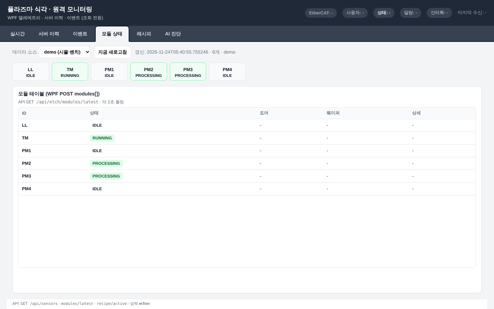

# Flask-etchflask - 식각 장비 원격 모니터링·AI 진단 서버

> 📂 [포트폴리오 (Notion)](https://iced-tarsier-455.notion.site/350af40f5e6680d19f93f1653925a3b8) · 🔗 현장 HMI: [etch_ui (WPF)](https://github.com/yaong832/etch_ui)

플라즈마 식각 장비의 WPF HMI([etch_ui](https://github.com/yaong832/etch_ui))가 보내는 센서·모듈·레시피 데이터를 받아 **웹 대시보드로 보여 주고, 이력을 저장하고, AI로 이상 여부를 진단**하는 Flask 서버입니다.
장비 제어(시작·정지, 인터락 변경)는 하지 않습니다. 제어는 현장 PC의 WPF HMI에서만 합니다.



---

## 구성

```
현장 PC                                             모니터링 PC
┌──────────────────────┐   POST /api/etch/sensor-data   ┌─────────────┐
│ TwinCAT EtherCAT I/O │                                │   브라우저   │
│ etch_ui (WPF HMI) ───┼──► Flask (이 저장소) ◄─────────┼─ GET :5000  │
└──────────────────────┘        │  SQLite 이력(선택)     └─────────────┘
                                └─ AI 진단 (sklearn 모델 / 규칙 폴백)
```

- **live / demo 분리**: EtherCAT 실측 데이터(`live`)와 시뮬·벤치 데이터(`demo`)를 따로 저장해서, 데모가 실가공 이력에 섞이지 않습니다.
- **AI 진단**: `models/etch/`의 scikit-learn 모델(이상 분류·알람 분류)로 추론하고, 모델이 없으면 규칙 기반으로 대신 판단합니다. 자세한 내용: [ETCH_AI.md](ETCH_AI.md)

## 대시보드 탭

실시간 · 서버 이력 · 이벤트 · 모듈 상태 · 레시피 · AI 진단. 처음 쓰는 사람용 설명: [사용자_가이드.md](사용자_가이드.md)

---

## 설치와 실행

Python 3.11 이상이 필요합니다.

```bash
python -m venv venv
venv\Scripts\activate          # macOS/Linux: source venv/bin/activate
pip install -r requirements.txt
python app.py
```

Windows에서는 `run_flask.bat`을 더블클릭해도 됩니다 (패키지 설치 후 실행).

- 같은 PC: http://127.0.0.1:5000
- 다른 PC: `http://<서버 PC의 LAN IP>:5000` (Windows 방화벽 인바운드 TCP 5000 허용 필요). 자세한 구성: [REMOTE_MONITORING.md](REMOTE_MONITORING.md)
- PyCharm에서 실행: [README_PYCHARM.md](README_PYCHARM.md)

### 환경 변수

| 변수 | 기본값 | 뜻 |
| --- | --- | --- |
| `ETCH_FLASK_HOST` | `0.0.0.0` | 바인딩 주소. 같은 PC에서만 쓸 거면 `127.0.0.1` |
| `ETCH_FLASK_PORT` | `5000` | 포트 |
| `ETCH_USE_DB` | 꺼짐 | `1`이면 이력을 `data/etch_monitoring.db`(SQLite)에 저장, 아니면 메모리에만 |
| `ETCH_FLASK_DEBUG` | 꺼짐 | `1`이면 Flask 디버그 모드. 개발할 때만 켜세요 |

> ⚠️ 인증이 없는 서버입니다. 학교·사내처럼 믿을 수 있는 네트워크에서만 여세요.

> 스마트팜용 Flask([Flask-SmartFarmFlask](https://github.com/yaong832/Flask-SmartFarmFlask))와 같은 5000 포트를 쓰므로 동시에 실행하지 마세요. [FARMUI_분리안내.md](FARMUI_분리안내.md)

---

## API

| 메서드 | 경로 | 설명 |
| --- | --- | --- |
| GET | `/` | 대시보드 |
| POST | `/api/etch/sensor-data` | WPF 텔레메트리 수신 (센서·모듈·레시피). 저장 시 AI 진단 자동 실행 |
| GET | `/api/sensors` | 최신 센서 스냅샷 |
| GET | `/api/etch/history` | 센서 이력 |
| GET, POST | `/api/etch/events` | 이벤트(알람·상태 변화) 조회·추가 |
| GET | `/api/etch/modules/latest?source=demo\|live` | 모듈(LL·TM·PM1~4) 상태 |
| GET | `/api/etch/recipe/active?source=demo\|live` | 현재 레시피 |
| GET | `/api/etch/summary` | 요약 통계 |
| GET | `/api/etch/ai/status` | AI 모델 상태 |
| POST | `/api/etch/ai/predict` | 수동 추론 |
| GET | `/api/etch/ai/latest` | 최근 AI 진단 (WPF·웹이 폴링) |
| GET | `/api/logs`, `/api/load-logs` · POST `/api/add-logs` | 메모리 로그 조회·추가 |

센서 숫자는 `sensorsLive=true`이고 EtherCAT 실측일 때만 표시합니다 (WPF와 같은 규칙).

## 파일

| 파일 | 역할 |
| --- | --- |
| `app.py` | Flask 라우트 |
| `data_manager.py` | 수신 데이터 분류(live/demo), 캐시, 이력 |
| `etch_persistence.py` | SQLite 저장 |
| `etch_ai.py`, `etch_model.py` | AI 진단 (모델 / 규칙 폴백) |
| `recipe_engine.py` | 레시피 정규화 |
| `etch_config.py` | 압력 기준값, 바인딩 설정 |
| `templates/etch_dashboard.html` | 대시보드 (단일 HTML) |
| `models/etch/` | 학습된 모델과 manifest |
